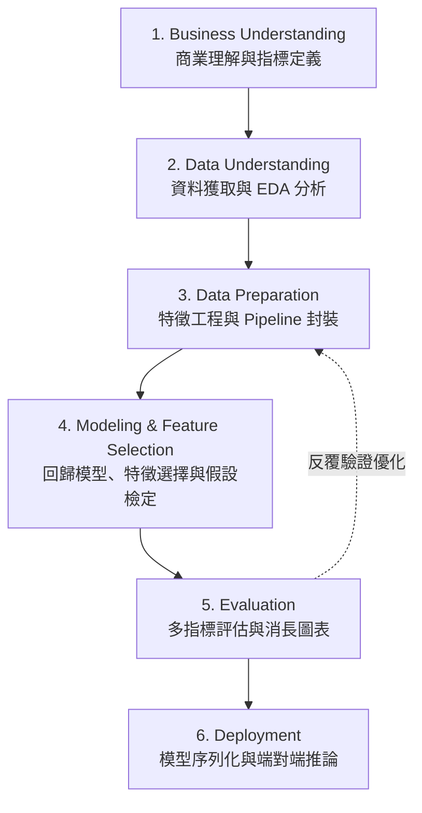
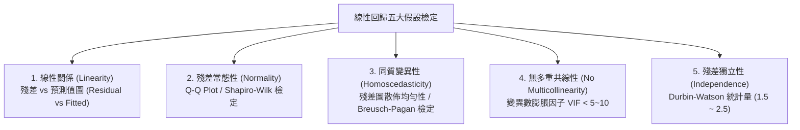

# 50 Startups 多元線性回歸專案規劃書 (PROJECT PLAN)
**基於 CRISP-DM 框架的端對端機器學習實作指引**

---

## 一、專案概述與總覽

本專案旨在透過資料科學與機器學習方法，分析 **50 Startups（50 家新創公司）** 的各項經營支出（研發費用、行政管理費用、市場行銷費用）及所處地理區域（州別），建立高解釋性與高預測能力的**多元線性回歸模型（Multiple Linear Regression, MLR）**，以精準預測新創公司的淨利潤（Profit）。

專案採用跨行業資料探勘標準流程 **CRISP-DM（Cross-Industry Standard Process for Data Mining）** 作為核心架構，確保從商業目標、資料準備、模型建構、統計假設檢驗到部署推論皆具備嚴謹性、模組化與可維護性。

---

## 二、CRISP-DM 六大階段詳細規劃



---

### 階段 1：Business Understanding (商業理解)

#### 1.1 商業背景與痛點
創業投資機構（Venture Capital, VC）與企業經營者在評估新創公司時，面臨高度不確定性與資源配置挑戰。不同業務部門（研發、行政、行銷）的資金投入對最終營收獲利的回報率（ROI）存在顯著差異，若無法精準量化各項開支對利潤的邊際貢獻，容易導致資本錯配與經營虧損。

#### 1.2 商業目標 (Business Objectives)
1. **利潤精準預測**：依據新創公司的開銷結構與所在區域，精準預估其未來利潤。
2. **資本配置最佳化**：釐清研發、管理、行銷三大開支對利潤的影響權重，提供投資人與創辦人客觀的預算分配決策依據。
3. **區域營運差異分析**：評估不同地理市場（如 New York, California, Florida）是否對利潤率產生顯著溢價或折扣。

#### 1.3 評估指標設定 (Evaluation Metrics)
為了全面評估多元線性回歸模型的預測精確度與泛化能力，設定以下四項關鍵統計指標：

| 指標名稱 | 數學定義 | 商業與統計意義 |
| :--- | :--- | :--- |
| **MAE (Mean Absolute Error)** | $\frac{1}{n}\sum_{i=1}^{n} \|y_i - \hat{y}_i\|$ | 平均絕對誤差：以美元為單位，直觀衡量預測值與實際值之平均差距，對極端值相對不敏感。 |
| **MSE (Mean Squared Error)** | $\frac{1}{n}\sum_{i=1}^{n} (y_i - \hat{y}_i)^2$ | 均方誤差：放大較大誤差之懲罰力道，作為優化演算法之損失函數。 |
| **RMSE (Root Mean Squared Error)** | $\sqrt{\frac{1}{n}\sum_{i=1}^{n} (y_i - \hat{y}_i)^2}$ | 均方根誤差：回歸至原始金額單位（USD），對大幅預測失誤敏感，為主要回歸評估指標。 |
| **$R^2$ (Coefficient of Determination)** | $1 - \frac{\sum (y_i - \hat{y}_i)^2}{\sum (y_i - \bar{y})^2}$ | 決定係數：衡量模型所能解釋的利潤變異比例，介於 0 至 1 之間，越接近 1 表示擬合度越佳。 |

---

### 階段 2：Data Understanding (資料理解)

#### 2.1 資料來源與規格
- **資料網址**：`https://gist.githubusercontent.com/GaneshSparkz/b5662effbdae8746f7f7d8ed70c42b2d/raw/faf8b1a0d58e251f48a647d3881e7a960c3f0925/50_Startups.csv`
- **資料筆數與維度**：50 筆觀測樣本（Rows），5 個特徵欄位（Columns）。
- **資料格式**：CSV 格式，直接透過程式碼遠端串接載入。

#### 2.2 欄位結構定義說明

| 欄位名稱 (Column Name) | 資料類型 | 特徵角色 | 意義說明 |
| :--- | :--- | :--- | :--- |
| **R&D Spend** | Continuous (Float) | 自變數 (Feature) | 研發經費投入總額（美元） |
| **Administration** | Continuous (Float) | 自變數 (Feature) | 行政與管理開支總額（美元） |
| **Marketing Spend** | Continuous (Float) | 自變數 (Feature) | 市場推廣與行銷費用總額（美元） |
| **State** | Categorical (String) | 自變數 (Feature) | 新創公司註冊營運所在州別（紐約、加州、佛羅里達） |
| **Profit** | Continuous (Float) | 應變數 (Target $Y$) | 淨利潤總額（美元） |

#### 2.3 探索性資料分析 (EDA) 規劃
1. **基礎統計檢視**：
   - 計算各數值特徵之均值（Mean）、標準差（Std）、中位數、四分位距（IQR）、偏態係數（Skewness）與峰度（Kurtosis）。
   - 檢查是否存在 0 元開支（如尚未開展行銷或研發的新創）。
2. **缺失值與重複值檢測**：
   - 檢測 `isnull().sum()` 與 `duplicated().sum()`。
3. **相關性矩陣與熱力圖 (Correlation Heatmap)**：
   - 計算數值型欄位之間的皮爾森相關係數（Pearson Correlation），初步判斷自變數與目標變數 $Y$ 的線性強度，以及自變數之間的潛在共線性。
4. **特徵分佈與關聯視覺化 (Pairplot & Boxplot)**：
   - 繪製散佈圖矩陣（Pairplot），觀察自變數對 Profit 的線性趨勢。
   - 依 State 繪製 Profit 盒狀圖（Boxplot），評估各州別之利潤中位數與離群值分佈。

---

### 階段 3：Data Preparation (資料準備)

#### 3.1 資料清洗與品質控制
- 檢查缺失值與極端異常值（如負值）。
- 檢驗特徵值範圍，針對 0 值樣本進行商業邏輯驗證（新創公司初期未編列行銷或研發預算屬合理現象，予以保留）。

#### 3.2 資料集切分 (Train/Test Split)
- **訓練集 (Training Set)**：佔比 80%（40 筆樣本），用於模型訓練、特徵選擇與參數估計。
- **測試集 (Testing Set)**：佔比 20%（10 筆樣本），完全獨立隔離，用於評估未見樣本的泛化表現。
- **隨機種子**：設定 `random_state=42` 確保實驗流程 100% 可重現（Reproducible）。

#### 3.3 特徵工程與管線封裝架構
為杜絕資料外洩（Data Leakage），所有標準化與編碼轉換均在 Pipeline 內先 `fit` 於訓練集，再 `transform` 於測試集。

```
                    ┌── 數值特徵 (R&D, Admin, Marketing) ──> StandardScaler ─────────────┐
輸入原始特徵 (X) ───┤                                                                    ├──> 合併特徵矩陣 ──> LinearRegression
                    └── 類別特徵 (State) ───────────────> OneHotEncoder (drop='first') ─┘
```

1. **數值型特徵處理**：
   - 採用 `StandardScaler` 進行 Z-Score 標準化（$\mu=0, \sigma=1$），消除量綱差異，提升係數可比性與回歸優化收斂效率。
2. **類別型特徵處理（避免虛擬變數陷阱）**：
   - 針對 `State` 欄位（包含 3 個類別：California, Florida, New York），採用 `OneHotEncoder(drop='first', sparse_output=False)`。
   - **虛擬變數陷阱（Dummy Variable Trap）防範機制**：若有 $K$ 個類別，僅轉換出 $K-1$ 個虛擬變數（保留 2 個特徵，以被剔除之類別作為 Baseline 基準組），避免矩陣產生完美多元共線性（Singular Matrix）。
3. **ColumnTransformer 與 Pipeline 整合**：
   - 使用 Scikit-Learn `ColumnTransformer` 將數值管線與類別管線平行整合。
   - 結合模型封裝為單一 `Pipeline(steps=[('preprocessor', preprocessor), ('regressor', LinearRegression())])`。

---

### 階段 4：Modeling & Feature Selection (模型建立與特徵選擇規劃)

#### 4.1 基準模型建立 (Baseline Model)
- 演算法：普通最小二乘法多元線性回歸（Ordinary Least Squares, OLS / `LinearRegression`）。
- 納入全部特徵（3 個數值特徵 + 2 個 One-Hot 虛擬變數，共 5 個特徵），建立 Baseline 模型並記錄測試集指標。

#### 4.2 特徵選擇實驗設計 (Feature Selection Experiment)
新創開銷項目可能存在冗餘特徵，過多非顯著特徵會增加模型變異度（Variance）。本專案規劃系統化特徵篩選實驗：
- **篩選演算法**：
  - 方案 A（優先）：**RFE (Recursive Feature Elimination，遞迴特徵消除)**，以線性回歸係數大小為依據迭代剔除最不重要特徵。
  - 方案 B：**SelectKBest ($f\_regression$)**，基於統計 F 檢定（F-test）顯著性選取 Top-K 特徵。
- **實驗網格**：設定特徵數量 $k \in \{1, 2, 3, 4, 5\}$。
- **追蹤指標**：針對每一種 $k$ 值，記錄模型在訓練集與測試集上的：
  - $R^2$ 決定係數
  - RMSE 均方根誤差
  - MAE 平均絕對誤差
- **實驗目的**：繪製消長趨勢圖，驗證「奧坎剃刀原則（Occam's Razor）」——在模型複雜度（特徵數）與預測精準度間尋找最優平衡點。

#### 4.3 線性回歸五大經典假設檢驗 (Classical MLR Assumptions & Diagnostics)
回歸模型建立後，必須驗證高斯-馬可夫定理（Gauss-Markov Theorem）的五大核心假設，確保估計量具備最佳線性無偏估計（BLUE）特性：



1. **線性關係 (Linearity)**：
   - 檢驗方法：繪製預測值（Fitted Values）對殘差（Residuals）的散佈圖。
   - 判定標準：殘差應隨機均勻分佈在 0 刻度水平線兩側，無明顯二次曲線或趨勢特徵。
2. **殘差常態性 (Normality of Residuals)**：
   - 檢驗方法：繪製標準化殘差的常態 Q-Q 圖（Normal Q-Q Plot）及殘差分佈直方圖；輔以 Shapiro-Wilk 統計檢定。
   - 判定標準：點群緊密貼合 45 度對角線，檢定 $p\text{-value} > 0.05$。
3. **同質變異性 (Homoscedasticity)**：
   - 檢驗方法：觀察殘差散佈圖是否存在漏斗狀（Funnel shape）擴散；使用 Breusch-Pagan 檢定。
   - 判定標準：殘差變異不隨預測值擴大而顯著發散。
4. **無嚴重多重共線性 (No Severe Multicollinearity)**：
   - 檢驗方法：計算自變數的**變異數膨脹因子（Variance Inflation Factor, VIF）**。
   - 判定標準：$\text{VIF}_j = \frac{1}{1 - R_j^2}$，所有特徵 VIF 值應小於 5（或小於 10 之嚴格門檻）。
5. **殘差獨立性 (Independence / No Autocorrelation)**：
   - 檢驗方法：計算 Durbin-Watson (DW) 統計量。
   - 判定標準：DW 值介於 1.5 到 2.5 之間，表示殘差間無顯著一階自相關。

---

### 階段 5：Evaluation (模型評估規劃)

#### 5.1 模型整體成效與對比表
輸出各組特徵組合在測試集上的性能對比表：

| 實驗組別 | 使用特徵數量 | 納入特徵清單 | 測試集 $R^2$ | 測試集 RMSE (USD) | 測試集 MAE (USD) | 備註說明 |
| :---: | :---: | :---: | :---: | :---: | :---: | :---: |
| Model_k1 | 1 | e.g. [R&D Spend] | TBD | TBD | TBD | 單變數基線 |
| Model_k2 | 2 | e.g. [R&D, Marketing] | TBD | TBD | TBD | 核心兩大開銷 |
| Model_k3 | 3 | e.g. [R&D, Admin, Marketing] | TBD | TBD | TBD | 全數值特徵 |
| Model_k4 | 4 | e.g. [數值 + State_1] | TBD | TBD | TBD | 加入部分區域 |
| Model_k5 | 5 | 全部 5 項特徵 (Baseline) | TBD | TBD | TBD | 完整模型 |

#### 5.2 視覺化產出規劃 (Plots & Figures)
評估模組將自動生成並儲存以下高解析度圖表（存於 `reports/figures/` 目錄）：
1. `feature_selection_trend.png`：特徵數（1 到 5）對應 $R^2$ 與 RMSE 的消長雙軸折線圖。
2. `actual_vs_predicted.png`：測試集實際利潤 vs 預測利潤對角擬合圖。
3. `residual_diagnostics.png`：殘差診斷四合一圖（殘差直方圖、殘差 vs 預測值圖、Normal Q-Q Plot、Scale-Location 圖）。

#### 5.3 回歸係數與商業實務解釋 (Feature Coefficients & Business Insights)
- 提取最終推薦模型的回歸方程式截距 $\beta_0$ 與各係數 $\beta_j$。
- 解析每投入 1 單位研發、管理或行銷費用，預期帶來多少美元的利潤增長，提供高層管理者直觀的預算配置指引。

---

### 階段 6：Deployment (部署與推論規劃)

#### 6.1 模型序列化 (Model Serialization)
- 採用 Python 標準科學計算序列化工具 `joblib`。
- 將包含前處理（`StandardScaler` + `OneHotEncoder`）與最佳線性回歸估計器的完整 `Pipeline` 物件持久化儲存至 `models/startup_profit_model.pkl`。
- **優勢**：在生產環境進行推論時，輸入原始未加工之 DataFrame 即可一步到位輸出預測值，避免特徵工程程式碼脫鉤。

#### 6.2 端對端推論展示 (Inference Engine)
設計具備容錯力與型態校驗的推論函式，支援批次或單筆推論：
```python
# 推論範例格式
sample_startup = pd.DataFrame([
    {
        'R&D Spend': 165349.20,
        'Administration': 136897.80,
        'Marketing Spend': 471784.10,
        'State': 'New York'
    },
    {
        'R&D Spend': 100000.00,
        'Administration': 110000.00,
        'Marketing Spend': 250000.00,
        'State': 'California'
    }
])
predicted_profit = model_pipeline.predict(sample_startup)
```

---

## 三、專案目錄結構規劃

為維持專業軟體工程水準，專案目錄規劃如下：

```
c:\物聯網\HW4\
├── models/                         # 存放序列化模型檔案
│   └── startup_profit_model.pkl    # 訓練完成之 Pipeline 模型
├── reports/                        # 專案報表與視覺化圖表存放處
│   └── figures/                    # 產出之統計與評估圖表
│       ├── feature_selection_trend.png
│       ├── actual_vs_predicted.png
│       └── residual_diagnostics.png
├── data/                           # (選用) 暫存快取或下載之原始資料
│   └── 50_Startups.csv
├── PROJECT_PLAN.md                 # 專案總體規劃與架構說明文件 (當前文件)
├── requirements.txt                # 專案相依 Python 套件清單
├── main.py                         # 端對端執行主程式 (包含載入、EDA、建模、檢驗、評估與導出)
└── README.md                       # 專案成果摘要與執行說明指引
```

---

## 四、環境相依與套件需求 (`requirements.txt`)

專案將嚴格控制環境相依性，預計採用以下穩定版本之資料科學函式庫：

```txt
numpy>=1.24.0
pandas>=2.0.0
scikit-learn>=1.3.0
matplotlib>=3.7.0
seaborn>=0.12.0
statsmodels>=0.14.0
joblib>=1.3.0
requests>=2.31.0
```

---

## 五、程式實作執行架構與步驟規劃

待使用者核准本規劃後，將依序展開以下工程步驟：

1. **環境配置**：建立 `requirements.txt` 並驗證 Python 環境相依套件是否完整。
2. **建立專案基礎設施**：建立 `models/`、`reports/figures/` 目錄。
3. **主程式模組化實作 (`main.py`)**：
   - `load_data()`: 透過遠端 URL 串接並載入資料。
   - `exploratory_data_analysis()`: 產出敘述統計、相關係數矩陣與 EDA 摘要。
   - `build_pipeline()`: 構建 `ColumnTransformer` (StandardScaler + OneHotEncoder drop='first') 與 Pipeline。
   - `feature_selection_study()`: 執行 1~5 特徵選擇實驗，記錄指標並繪製消長趨勢圖。
   - `verify_assumptions()`: 執行五大經典回歸統計檢定（殘差常態性、同質性、VIF、DW 檢定）。
   - `train_final_model()`: 訓練最佳/基準模型，並輸出 MAE, MSE, RMSE, R²。
   - `export_model()`: 將 Pipeline 序列化儲存至 `models/startup_profit_model.pkl`。
   - `run_inference_demo()`: 載入已儲存模型，針對新創測試樣本進行端對端推論展示。
4. **驗證與成果交付**：執行 `main.py` 產出完整紀錄與報表，確認圖表與模型正常生成。
